# Flight & Hotel Reservation Platform - Spring Boot Microservices

A reference implementation of a MakeMyTrip-style **flight + hotel booking and travel-budget-estimator** platform built with
**Java 21, Spring Boot 3.3, Spring Cloud 2023.0, PostgreSQL, Kafka + Debezium, Redis, Keycloak/Cognito, Docker, Kubernetes (EKS) and Terraform**.

It demonstrates production patterns end to end: API Gateway with rate limiting, OAuth2/OIDC JWT security, RBAC + ABAC, service discovery,
CQRS, Transactional Outbox + Debezium CDC, an event-driven Saga with retry topics and a Dead Letter Topic, circuit breakers, a two-level cache,
virtual threads, mTLS, observability and multi-AZ AWS infrastructure as code.

> **Honest status note.** The Java code was written to compile against Spring Boot 3.3.5 / Spring Cloud 2023.0.3, but the full multi-module build,
> the Kubernetes manifests and the Terraform have **not** been executed against a real cluster/AWS account by the author of this document.
> What *was* executed and verified: the SQL schema, the sample data, the budget query and the partition pruning (on PostgreSQL 16), and the syntax
> of all JSON/YAML/XML files. Treat the cloud pieces as a well-structured starting point you validate in a sandbox account first.

---

## Table of contents

1. [Business context & scope](#1-business-context--scope)
2. [Architecture - the C4 model (HLD → LLD)](#2-architecture---the-c4-model-hld--lld)
3. [Microservice deep dive (six parameters each)](#3-microservice-deep-dive-six-parameters-each)
4. [End-to-end workflow](#4-end-to-end-workflow)
5. [Failure scenarios & compensation flows](#5-failure-scenarios--compensation-flows)
6. [Design patterns used - where, when, how](#6-design-patterns-used---where-when-how)
7. [Transactional Outbox vs Debezium CDC - the complete Q&A](#7-transactional-outbox-vs-debezium-cdc---the-complete-qa)
8. [Minimum Estimated Travel Budget - all SQL](#8-minimum-estimated-travel-budget---all-sql)
9. [Run locally - step by step](#9-run-locally---step-by-step)
10. [Testing guide](#10-testing-guide)
11. [AWS edge: Route 53, WAF, Shield Advanced, CloudFront](#11-aws-edge-route-53-waf-shield-advanced-cloudfront)
12. [Terraform walkthrough (and why Terraform, not Ansible)](#12-terraform-walkthrough-and-why-terraform-not-ansible)
13. [Kubernetes walkthrough for beginners](#13-kubernetes-walkthrough-for-beginners)
14. [Observability](#14-observability)
15. [Repository layout, known limitations, troubleshooting](#15-repository-layout-known-limitations-troubleshooting)

---

## 1. Business context & scope

Travellers start from an origin airport (e.g. **Kolkata `CCU`**) and want to know *"how much will this trip cost at minimum?"* for a destination such as
Delhi `DEL`, Bangalore `BLR`, Bangkok `BKK`, Phuket `HKT`, Kuala Lumpur `KUL`, Penang `PEN`, Ho Chi Minh City `SGN`, Hanoi `HAN` or Dubai `DXB`.

| Capability | Where |
|---|---|
| Search flights / hotels, **estimate minimum trip budget** (cheapest flight + cheapest hotel × nights × rooms + sightseeing fees) | `flight-hotel-query-service` |
| Create / cancel bookings (commands) | `booking-command-service` |
| Charge / refund payments, compensate failures | `payment-saga-service` |
| Authentication, rate limiting, routing, CORS | `api-gateway` + Keycloak/Cognito |
| Central config, service registry | `config-server`, `discovery-server` |

**Out of scope in this demo (deliberately simplified):** real seat/room inventory locking, a real payment provider, hotel booking lines, email/SMS notifications.
See [Known limitations](#known-limitations).

**Technology stack:** Java 21 (virtual threads) · Spring Boot 3.3.5 · Spring Cloud 2023.0.3 (Gateway, Config, Eureka, LoadBalancer) · Spring Security
OAuth2 Resource Server · Spring Data JPA/Hibernate 6 · PostgreSQL 16 · Apache Kafka (KRaft) · Debezium 2.7 · Redis 7 · Caffeine · Resilience4j 2.2 ·
Micrometer + OpenTelemetry · Prometheus/Grafana/Jaeger · Docker · Kubernetes (EKS) · Terraform (AWS provider 5.x).

---

## 2. Architecture - the C4 model (HLD → LLD)

The **C4 model** describes software at four zoom levels. We use it as the HLD/LLD map:

| C4 level | Question it answers | Design level | Section |
|---|---|---|---|
| **1 - System Context** | Who uses the system and what does it talk to? | HLD | 2.1 |
| **2 - Containers** | Which deployable units exist and how do they talk? | HLD | 2.2 |
| **3 - Components** | What is inside each container? | LLD | 2.3 |
| **4 - Code** | Which classes/tables implement it? | LLD | 2.4 |

### 2.1 Level 1 - System Context (HLD)

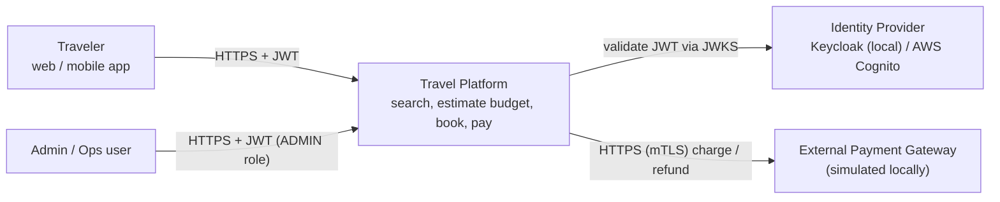

### 2.2 Level 2 - Containers (HLD)

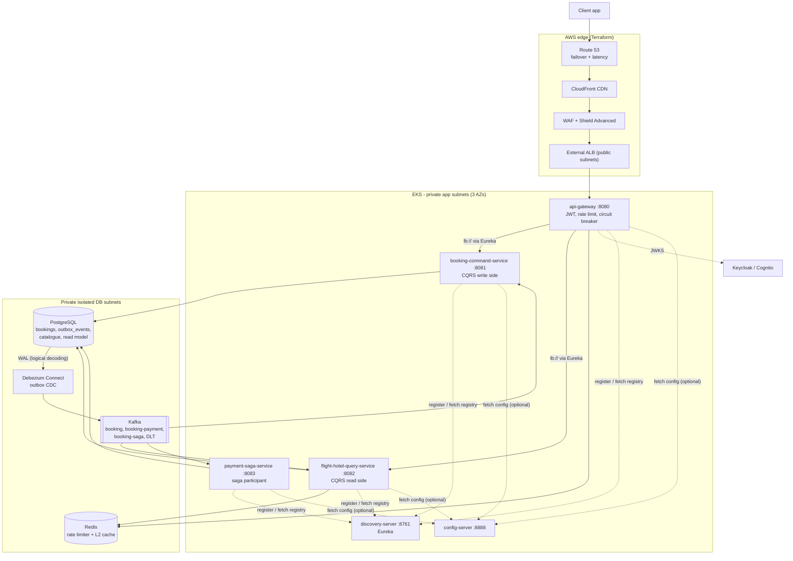

**Key architectural decisions (ADR summary)**

| # | Decision | Why |
|---|---|---|
| 1 | CQRS: separate write (`booking-command-service`) and read (`flight-hotel-query-service`) services | Different scaling/caching profiles; reads dominate writes by orders of magnitude |
| 2 | Transactional Outbox + Debezium CDC instead of publishing to Kafka from application code | Atomic "state change + event" without distributed transactions (no dual-write) |
| 3 | Saga over Kafka for booking → payment | Services own their data; no 2PC across services |
| 4 | Kafka topic == `aggregatetype` (`booking`, `booking-payment`, `booking-saga`) | Debezium EventRouter routes rows to topics by that column |
| 5 | Gateway-level and service-level JWT validation | Zero trust: a compromised gateway cannot forge identity downstream |
| 6 | mTLS between pods via cert-manager + Spring SSL bundles | Encrypt and authenticate east-west traffic |
| 7 | Terraform for AWS, plain Kubernetes YAML for workloads | Clear separation: cloud resources vs application deployment |

### 2.3 Level 3 - Components (LLD)

**booking-command-service**

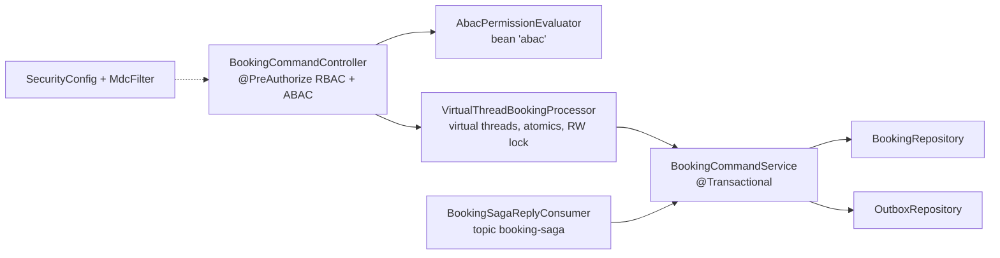

**flight-hotel-query-service**

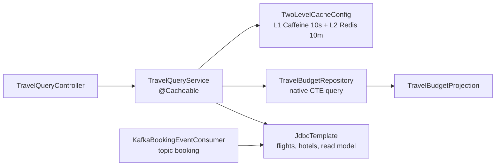

**payment-saga-service**

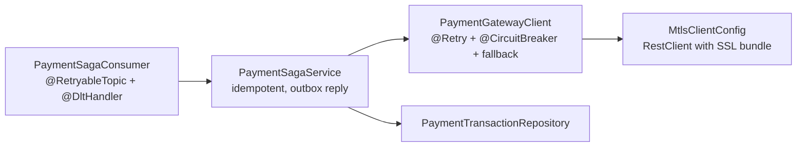

**api-gateway**

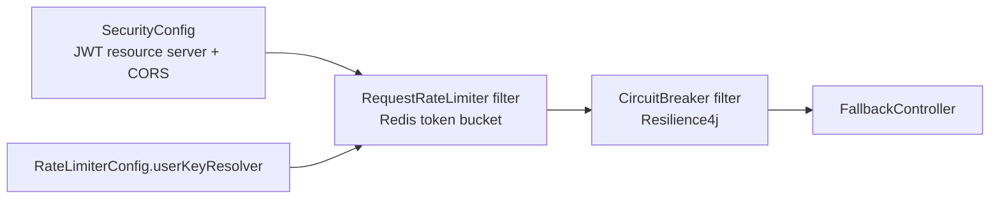

### 2.4 Level 4 - Code (LLD)

**Entity-relationship diagram (`db/V1__init_travel_schema.sql`)**

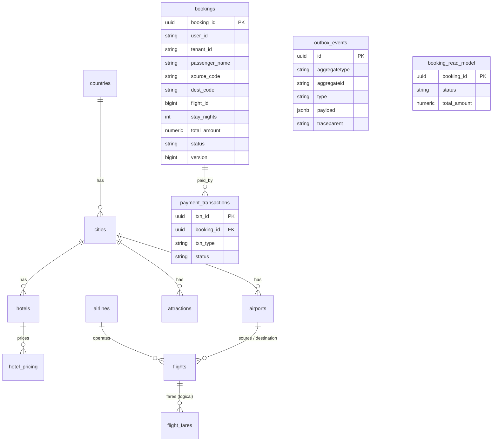

**Booking status state machine (saga state lives in `bookings.status`)**

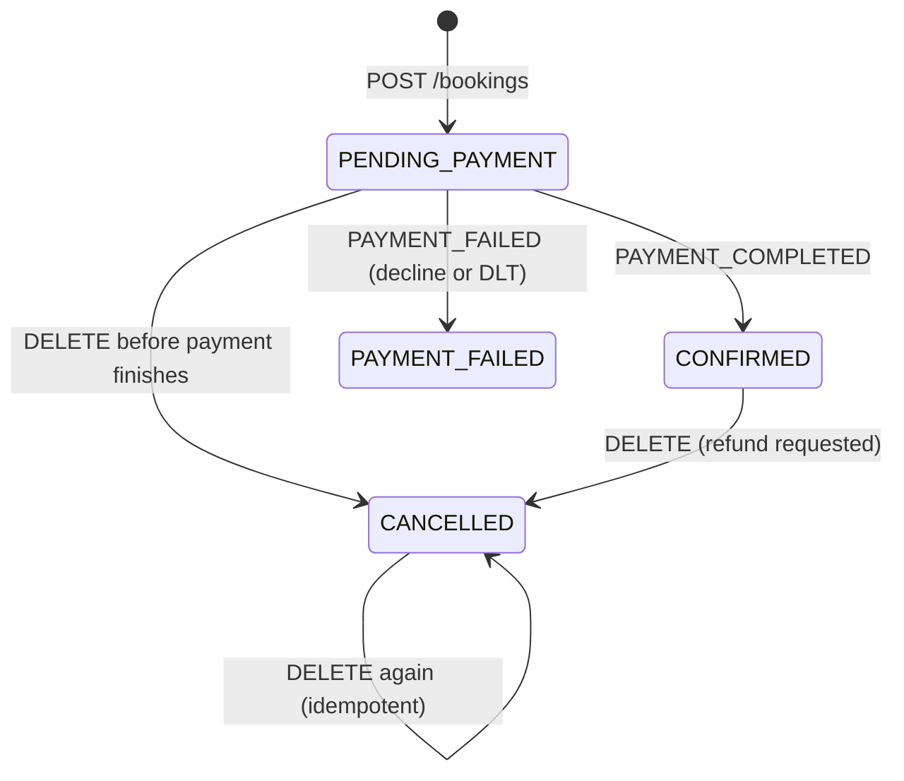

**Key classes**

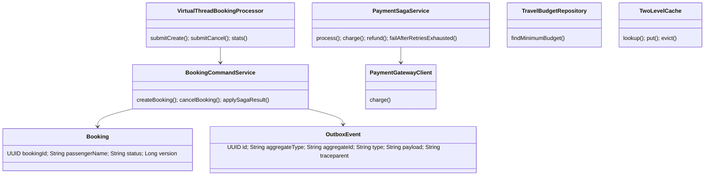

**Package map (where to read the code)**

| Service | Package root | Read in this order |
|---|---|---|
| booking-command-service | `com.architecture.bookingcommand` | `controller` → `concurrency` → `service` → `domain` → `repository` → `consumer` → `config` |
| flight-hotel-query-service | `com.architecture.flighthotelquery` | `controller` → `service` → `repository` (SQL) → `dto` → `config/TwoLevelCacheConfig` → `consumer` |
| payment-saga-service | `com.architecture.payment` | `consumer` → `service` → `domain` → `config` |
| api-gateway | `com.architecture.gateway` | `resources/application.yml` (routes) → `config` → `controller` |

---

## 3. Microservice deep dive (six parameters each)

> **About the numbers.** "Targets" below are **design targets / proposed SLOs** used for capacity planning and HPA settings. They have **not** been
> load-tested. Metric names are real Micrometer/Prometheus metric names that the services expose (`/actuator/prometheus`).

### 3.1 config-server (port 8888)

**1. Primary purpose & key responsibilities**
- Serves centralised external configuration (Spring Cloud Config Server, `native` profile reading `classpath:/config/`).
- Holds cross-cutting defaults (`config/application.yml`, e.g. Kafka observation flags) delivered to every client.
- Clients import it with `spring.config.import: optional:configserver:...`, so a missing config server never blocks start-up.

**2. Measuring success (KPIs)**
- Config fetch success rate ≥ 99.9 %; fetch latency p95 < 200 ms (`http_server_requests_seconds` for `/{app}/{profile}`).
- Zero config-drift incidents (all environments get the same files via Git/classpath).
- Time to roll out a config change (minutes, not redeploys - when moved to a Git backend).

**3. Data flow, response times & failure impact**
- Flow: service boot → `GET /{application}/{profile}` → property sources merged into the Spring `Environment`.
- Response time: tens of milliseconds (static files).
- Failure impact: **low** - `optional:` means clients fall back to their bundled `application.yml`. Running instances are unaffected; only a restart during the outage loses centrally-managed overrides.

**4. Technologies, advantages & limitations**
- Spring Cloud Config Server. + Central, versionable config, profile support. − Native/classpath backend is baked into the jar (no live refresh); no encryption/Git backend configured; extra moving part.
- Production upgrade path: Git backend + `spring-cloud-bus`/`/actuator/refresh`, or replace with Kubernetes ConfigMaps/AWS Parameter Store.

**5. Scalability & performance targets**
- Stateless; 2 replicas (see `k8s/workloads.yaml`), ~hundreds of fetches/second per pod is far above the need (fetches happen only at start-up).

**6. Security, reliability & compliance**
- Currently unauthenticated and internal-only (ClusterIP service, never exposed through the ALB). Add Spring Security + mTLS/Basic auth before storing anything sensitive.
- Never store secrets in it: secrets come from `platform-secrets` (Kubernetes Secret → AWS Secrets Manager via External Secrets in production).
- Reliability: 2 replicas across AZs; clients tolerate absence.

### 3.2 discovery-server - Eureka (port 8761)

**1. Primary purpose & key responsibilities**
- Service registry: every service registers its IP/port + health; consumers resolve logical names (`lb://booking-command-service`) to live instances.
- Client heartbeats (30 s default) and eviction of dead instances (`eviction-interval-timer-in-ms: 5000`).

**2. Measuring success (KPIs)**
- Registered instances == expected replicas (`/eureka/apps`); registry staleness < 30 s.
- Routing error rate caused by dead instances (gateway 5xx with `UnknownHost`/connection refused) ≈ 0.
- Eureka self-preservation not stuck on.

**3. Data flow, response times & failure impact**
- Flow: start-up register → heartbeat renewals → clients fetch registry delta every 30 s and cache it → Spring Cloud LoadBalancer picks an instance client-side.
- Response time: registry reads are in-memory (< 10 ms).
- Failure impact: **medium/low** - clients keep using their cached registry, so existing traffic continues; **new instances become invisible** and dead ones are not removed until Eureka returns.

**4. Technologies, advantages & limitations**
- Netflix Eureka. + AP-style (favours availability), simple, client-side load balancing. − Eventual consistency (stale entries for up to a lease period), peer replication needs configuration (single node here), duplicates what Kubernetes DNS/Services already give you.

**5. Scalability & performance targets**
- Handles thousands of instances; here 2 replicas. Run ≥ 3 peers with `eureka.client.service-url.defaultZone` listing each other for real HA.

**6. Security, reliability & compliance**
- Dashboard and API are open (internal network only). Add authentication before exposure. Self-preservation protects against mass eviction during network partitions.

### 3.3 api-gateway (port 8080)

**1. Primary purpose & key responsibilities**
- Single entry behind the external ALB: **JWT validation**, **CORS**, **rate limiting** (Redis token bucket), **routing** (`/api/v1/bookings/**` → command, `/api/v1/travel/**` → query), **circuit breaking** with a friendly 503 fallback.
- Relays the `Authorization` header downstream (services re-validate - zero trust).

**2. Measuring success (KPIs)**
- Gateway overhead p95 < 20 ms; availability ≥ 99.95 %.
- Rate-limited share (HTTP 429) tracked per route (Grafana panel "Gateway rate-limited").
- Circuit breaker state/open ratio (`resilience4j_circuitbreaker_state`); 401/403 anomaly rate.

**3. Data flow, response times & failure impact**
- Flow: ALB → Spring Security (JWT) → RequestRateLimiter (Redis Lua script) → CircuitBreaker → LoadBalancer (Eureka) → downstream.
- Response time: adds a few ms (Redis round trip + proxy hop). Downstream timeout 5 s (time limiter).
- Failure impact: **critical** - if all gateway pods are down, nothing is reachable. If **Redis** is down the rate limiter fails open/closed according to the filter's `deny-empty-key` and error handling (verify in your environment); if a downstream is down only that route returns the 503 fallback.

**4. Technologies, advantages & limitations**
- Spring Cloud Gateway (WebFlux/Netty), Redis, Resilience4j. + Non-blocking, declarative routes, rich filters. − Reactive programming model; Redis is a dependency of every request; rate limiting is per-key not global; no WAF (that is AWS WAF's job).

**5. Scalability & performance targets**
- Stateless, HPA 3→30 pods on CPU 70 %/memory 80 %. Targets: ≥ 5 000 rps total at p95 < 50 ms gateway latency (to validate by load test).
- Limits: booking route 50 rps sustained / burst 100 per user; travel route 200 / 400.

**6. Security, reliability & compliance**
- OAuth2 resource server (issuer-uri / JWKS), only `/api/**` authenticated, everything else `denyAll` except health/prometheus/fallback.
- CORS allow-list (`CORS_ALLOWED_ORIGINS`), CSRF disabled (stateless bearer tokens).
- Edge protections (WAF, Shield, TLS 1.3 at ALB) are provisioned by Terraform; mTLS to downstream with the `mtls` profile.

### 3.4 booking-command-service (port 8081) - CQRS write side

**1. Primary purpose & key responsibilities**
- Accepts **commands**: `CREATE_BOOKING` (`POST /api/v1/bookings`) and `CANCEL_BOOKING` (`DELETE /api/v1/bookings/{id}`).
- Writes the booking **and** its outbox events in **one local transaction** (Transactional Outbox).
- Owns the booking state machine: reacts to saga replies (`PAYMENT_COMPLETED` / `PAYMENT_FAILED`) from topic `booking-saga` and compensates (refund request when a cancelled booking was already paid).
- Enforces **RBAC** (`CUSTOMER`/`ADMIN`) and **ABAC** (tenant + user location).

**2. Measuring success (KPIs)**
- Command success rate ≥ 99.9 %; p95 latency < 150 ms (`http_server_requests_seconds{uri="/api/v1/bookings"}`).
- Outbox → Kafka publish lag < 1 s (Debezium); booking → CONFIRMED end-to-end p95 < 5 s.
- Stuck `PENDING_PAYMENT` bookings older than N minutes = 0; `processor-stats` `failed` counter flat.

**3. Data flow, response times & failure impact**
- Flow: HTTP → JWT → `@PreAuthorize` → virtual-thread task → `@Transactional` insert `bookings` + 2 `outbox_events` → HTTP 201. Everything after that is asynchronous.
- The response time is a single DB transaction (≈ tens of ms); it does **not** wait for payment.
- Failure impact: **high for writes** (no new bookings; reads and existing bookings unaffected). Because events are in the DB, a Kafka or Debezium outage delays - but never loses - downstream processing.

**4. Technologies, advantages & limitations**
- Spring MVC on Java 21 virtual threads, Spring Data JPA, PostgreSQL, Kafka listener (replies), optimistic locking (`@Version`).
- + Atomic write+event, simple blocking code scales via virtual threads. − The booking row does not verify the flight/hotel exist or hold inventory; the outbox table is never purged (add a cleanup job); events are *at-least-once* (consumers must be idempotent).

**5. Scalability & performance targets**
- Stateless, HPA 3→30 (CPU 70 %, memory 80 %, 1 000 rps/pod custom metric). Target ≈ 500 bookings/s cluster-wide with 3-4 pods; DB connection pool 30/pod (`DB_POOL`).
- Scale the DB vertically/with partitioning/sharding by `user_id` (see `db/SHARDING.md`).

**6. Security, reliability & compliance**
- JWT resource server; method security; ABAC (`tenant_id`, `user_location` claims); ownership check on cancel (`ROLE_ADMIN` may cancel any).
- Reliability: transactional outbox, optimistic locking, idempotent saga handler (state checks), Kafka consumer retries (Spring default error handler).
- Compliance notes: PII = `passenger_name`, `user_id` - mask in logs, encrypt at rest (RDS/KMS), define retention for `outbox_events`.

### 3.5 flight-hotel-query-service (port 8082) - CQRS read side

**1. Primary purpose & key responsibilities**
- Read-only queries: **minimum estimated budget** (`GET /api/v1/travel/estimate-budget`), flight search, hotel search, booking status (`/bookings/{id}`).
- Maintains the **read model** `booking_read_model` by consuming topic `booking`.
- Two-level cache (L1 Caffeine 10 s, L2 Redis 10 min) in front of the budget query.

**2. Measuring success (KPIs)**
- p95 latency < 100 ms uncached, < 10 ms L1 hit; combined cache hit ratio ≥ 80 %.
- Read-model freshness: event → row < 2 s; consumer lag (`kafka_consumer_fetch_manager_records_lag_max`) ≈ 0.
- Query correctness (the numbers in [section 8](#8-minimum-estimated-travel-budget---all-sql)).

**3. Data flow, response times & failure impact**
- Flow: HTTP → JWT → `@Cacheable` → L1 → L2 → native CTE SQL (partition-pruned, index-backed) → DTO → cache write-through.
- Failure impact: **medium** - search/estimate unavailable but bookings still work. **Redis down** → cache layer degrades to L1 + DB (errors are caught and logged). **Kafka down** → read model goes stale (status shows old value) until consumers catch up.

**4. Technologies, advantages & limitations**
- Spring MVC + virtual threads, JPA native query + interface projection, `JdbcTemplate`, Redis, Caffeine. + Very fast hot path, protects the DB. − Cache can serve data up to 10 minutes old (prices); the demo shares one Postgres instance with the write side (production: read replica/own DB); `Jdk` serialization for L2 values.

**5. Scalability & performance targets**
- Stateless; HPA 3→30; target ≥ 2 000 rps/pod for cached reads. Scale reads with Postgres read replicas; shard catalogue by `city_id` (see `db/SHARDING.md`).

**6. Security, reliability & compliance**
- JWT resource server, `hasAnyRole('CUSTOMER','ADMIN')`; parameter validation (`@Pattern`, `@Min`, `@Max`) blocks malformed input; SQL uses bind parameters (no injection).
- Booking lookup is by UUID but currently **not** restricted to the owner - add a `user_id` check for production (see limitations).

### 3.6 payment-saga-service (port 8083)

**1. Primary purpose & key responsibilities**
- Participant in the booking saga: consumes `booking-payment` commands (`PAYMENT_REQUESTED`, `REFUND_REQUESTED`), calls the payment gateway, records `payment_transactions`, and replies through the outbox on `booking-saga` (`PAYMENT_COMPLETED`, `PAYMENT_FAILED`, `PAYMENT_REFUNDED`).
- Handles retries (3 exponential Kafka retries), routes exhausted messages to **`booking-payment.DLT`**, and **compensates** from the DLT handler.
- Simulated gateway: a **passenger name starting with `FAIL` is declined** (`PAYMENT_SIMULATE=true`).

**2. Measuring success (KPIs)**
- Payment success rate (excluding legitimate declines) ≥ 99.5 %; p95 processing < 2 s.
- DLT depth = 0 (alert on any message in `booking-payment.DLT`); retry-topic depth; circuit breaker open time.
- Duplicate charges = 0 (idempotency).

**3. Data flow, response times & failure impact**
- Flow: Kafka → idempotency check → gateway call (outside any DB transaction) → one DB transaction (`payment_transactions` + outbox reply) → Debezium → `booking-saga`.
- Failure impact: **high for revenue, but contained** - bookings stay `PENDING_PAYMENT` until payment recovers; retry topics absorb transient errors; the DLT guarantees nothing is silently lost.

**4. Technologies, advantages & limitations**
- Spring Kafka `@RetryableTopic`, Resilience4j (`@Retry` + `@CircuitBreaker` + fallback), `RestClient` + SSL bundle (mTLS), JPA/JdbcTemplate.
- + Non-blocking retries (a failing message does not block the partition), clear DLT. − Retry topics add latency (1 s, 2 s, 4 s); gateway is simulated; refund path is simplified (no partial refunds, no gateway refund API call).

**5. Scalability & performance targets**
- Scale = number of partitions of `booking-payment` (retry topics are created with 3 partitions) × consumer pods. Target 300-500 payments/s with 3 pods.

**6. Security, reliability & compliance**
- No public HTTP API (only actuator). mTLS to the gateway when `mtls` profile active; secrets only from Kubernetes Secrets.
- Idempotency (`existsByBookingIdAndTxnType`) prevents double charging on redelivery. **PCI-DSS**: this service must never store PAN/CVV - only tokens/references (it stores none).

---

## 4. End-to-end workflow

```
POST /bookings
  -> bookings + 2 outbox_events rows (one transaction)
  -> Debezium
  -> topics `booking` (read-side projection) and `booking-payment` (saga command, retry topics + booking-payment.DLT)
  -> payment-saga-service
  -> outbox row on `booking-saga`
  -> Debezium
  -> booking-command-service sets CONFIRMED / PAYMENT_FAILED
```

### 4.1 Happy-path sequence

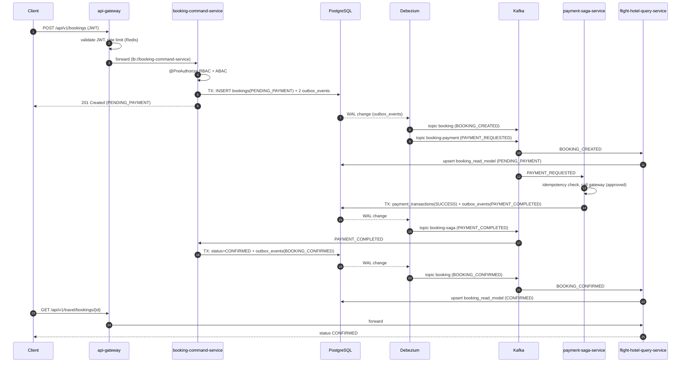

### 4.2 Step-by-step with the exact artefacts

| # | Step | Component / file | Data written | Kafka topic |
|---|---|---|---|---|
| 1 | Client sends command with JWT | `api-gateway` routes `booking-command` | - | - |
| 2 | JWT validated, rate limit checked, circuit breaker wraps call | `SecurityConfig`, `RequestRateLimiter` | Redis token bucket key | - |
| 3 | RBAC + ABAC evaluated | `BookingCommandController` `@PreAuthorize` | - | - |
| 4 | Command runs on a virtual thread | `VirtualThreadBookingProcessor.submitCreate` | atomic counters | - |
| 5 | **One transaction**: booking + two outbox rows | `BookingCommandService.createBooking` | `bookings` (`PENDING_PAYMENT`), `outbox_events` × 2 | - |
| 6 | HTTP 201 returned | controller | - | - |
| 7 | Debezium reads WAL, routes by `aggregatetype` | `debezium/postgres-outbox-connector.json` | - | `booking`, `booking-payment` |
| 8 | Read model projection | `KafkaBookingEventConsumer` | `booking_read_model` upsert | consumes `booking` |
| 9 | Payment executed | `PaymentSagaConsumer` → `PaymentSagaService.charge` → `PaymentGatewayClient` | `payment_transactions` + `outbox_events` (`booking-saga`) | consumes `booking-payment` |
| 10 | Saga reply published | Debezium | - | `booking-saga` |
| 11 | Booking confirmed or failed | `BookingSagaReplyConsumer` → `applySagaResult` | `bookings.status`, `outbox_events` (`BOOKING_CONFIRMED` / `BOOKING_PAYMENT_FAILED`) | consumes `booking-saga` |
| 12 | Read model updated | `KafkaBookingEventConsumer` | `booking_read_model.status` | consumes `booking` |

**Topics at a glance**

| Topic | Producer (via outbox) | Consumer | Purpose |
|---|---|---|---|
| `booking` | booking-command-service | flight-hotel-query-service | Read-model projection (non-saga use of the outbox) |
| `booking-payment` | booking-command-service | payment-saga-service | Saga command: charge / refund |
| `booking-payment-retry-*` | Spring Kafka (automatic) | payment-saga-service | Non-blocking retries (1 s, 2 s, 4 s) |
| `booking-payment.DLT` | Spring Kafka (automatic) | `@DltHandler` | Poison / exhausted messages → compensation |
| `booking-saga` | payment-saga-service | booking-command-service | Saga reply: completed / failed / refunded |

---

## 5. Failure scenarios & compensation flows

### 5.1 Declined payment - passenger name starts with `FAIL`

> **A passenger name starting with `FAIL` makes the simulated payment gateway decline, which triggers SAGA compensation.**

Condition: `payment.gateway.simulate=true` (default, env `PAYMENT_SIMULATE`). The rule lives in `PaymentGatewayClient.charge`:
a `passengerName` beginning with `FAIL` (case-insensitive) returns `PaymentResult.declined("SIMULATED_DECLINE_PASSENGER_NAME")`.

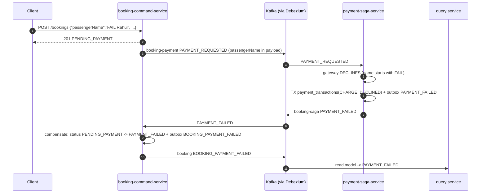

*Compensation in this demo* = the booking transitions to `PAYMENT_FAILED` (the "release the pending reservation" step). A decline is a **business
outcome, not an exception**, so there are **no Kafka retries and no DLT** - it completes in a few seconds. In a system with inventory holds,
this is where seats/rooms would be released.

Try it: Postman folder **4a**, or

```bash
curl -s -X POST http://localhost:8080/api/v1/bookings -H "Authorization: Bearer $TOKEN" -H "Content-Type: application/json" \
  -d '{"tenantId":"t1","passengerName":"FAIL Rahul","sourceCode":"CCU","destCode":"BKK","flightId":17,"stayNights":3,"totalAmount":16030}'
# poll: GET /api/v1/travel/bookings/{bookingId}  -> "status":"PAYMENT_FAILED"
```

### 5.2 Payment gateway down - retry topics → DLT → compensation

Start `payment-saga-service` with `PAYMENT_SIMULATE=false PAYMENT_GATEWAY_URL=http://localhost:9` (nothing listens there).

1. `PaymentGatewayClient.charge` fails → Resilience4j `@Retry` (3 attempts, 500 ms exponential) with the `@CircuitBreaker` recording every failure.
2. After the attempts (or when the circuit is open) the `@Retry` fallback returns `PaymentResult.deferred(...)`.
3. `PaymentSagaService` converts *deferred* into `PaymentUnavailableException` → Spring Kafka `@RetryableTopic`:
   `booking-payment` → `booking-payment-retry-1000` → `...-retry-2000` → `...-retry-4000` → **`booking-payment.DLT`** (3 retries, exponential).
4. `@DltHandler` calls `failAfterRetriesExhausted` → `payment_transactions(CHARGE, FAILED)` + outbox `PAYMENT_FAILED` → booking becomes `PAYMENT_FAILED`.

If the gateway recovers *during* the retries, the next attempt succeeds and the booking is confirmed normally (self-healing).

### 5.3 Customer cancels while payment is in flight

`PAYMENT_COMPLETED` arrives for a `CANCELLED` booking → `applySagaResult` sees the conflict and writes a `REFUND_REQUESTED` outbox event →
`payment-saga-service.refund` records a `REFUND` and replies `PAYMENT_REFUNDED`. (Cancelling an already `CONFIRMED` booking issues the refund request immediately.)

### 5.4 Other failure modes

| Failure | What happens | Protection |
|---|---|---|
| Duplicate Kafka delivery | Payment: `existsByBookingIdAndTxnType` skips; read model: idempotent upsert; saga reply: state check | Idempotent consumers |
| Malformed / poison message | `IllegalArgumentException` is excluded from retries → straight to DLT | `@RetryableTopic(exclude=...)` |
| Debezium / Kafka outage | Events remain in `outbox_events`; Debezium resumes from its replication slot and delivers later (watch WAL disk growth) | Outbox durability |
| Redis outage | L2 cache errors are caught → serve from L1/DB; gateway rate limiter depends on Redis (see 3.3) | Graceful degradation |
| Downstream service down | Gateway circuit breaker opens → `503` JSON from `FallbackController` | Resilience4j |
| Concurrent update of one booking | Hibernate `@Version` → optimistic-lock exception, retried by Kafka error handler | Optimistic locking |
| Invalid / expired token | `401` at the gateway (and again at the service) | OAuth2 resource server |
| Wrong tenant / location | `403` from ABAC | `AbacPermissionEvaluator` |

---

## 6. Design patterns used - where, when, how

| Pattern | Where | When it runs |
|---|---|---|
| API Gateway | `api-gateway` | Every external request |
| Rate Limiting (token bucket) | gateway `RequestRateLimiter` + Redis | Every request on a route with the filter |
| JWT + OAuth2/OIDC | gateway + each resource server | Every request |
| RBAC / ABAC | `@PreAuthorize`, `AbacPermissionEvaluator` | Before a command executes |
| Service Discovery | Eureka + Spring Cloud LoadBalancer | Gateway `lb://` resolution, start-up registration |
| Externalised config | `config-server` | Service start-up |
| CQRS | command vs query services | Writes vs reads |
| Transactional Outbox | `OutboxEvent`, `BookingCommandService.publish`, `PaymentSagaService.emit` | In the same transaction as every state change |
| CDC (Debezium) | Connector JSON | Continuously, from the WAL |
| Saga (event-driven, command/reply) | booking ↔ payment | Every booking/cancel |
| Retry + Dead Letter Topic | `@RetryableTopic`, `@DltHandler` | On payment processing failure |
| Circuit Breaker + Retry + Fallback | `PaymentGatewayClient`, gateway filter | On each outbound call |
| Idempotent consumer | payment, read model, saga reply | On redelivery |
| Cache-aside / two-level cache | `TwoLevelCacheConfig`, `@Cacheable` | Every budget estimate |
| Optimistic locking | `Booking.@Version` | Concurrent updates |
| Virtual-thread concurrency | `VirtualThreadBookingProcessor` | Each create/cancel command |
| mTLS / zero trust | SSL bundles + cert-manager | East-west traffic (`mtls` profile) |
| Distributed tracing | Micrometer OTel, `traceparent` in outbox/Kafka | Every request/event |

### 6.1 API Gateway with rate limiting - how it is implemented

- **Routes** are declared in `api-gateway/src/main/resources/application.yml` (`spring.cloud.gateway.routes`): `booking-command` (`Path=/api/v1/bookings/**` → `lb://booking-command-service`) and `travel-query` (`Path=/api/v1/travel/**` → `lb://flight-hotel-query-service`).
- **Rate limiting**: the built-in `RequestRateLimiter` filter uses `RedisRateLimiter`, an implementation of the **token bucket** algorithm executed as an atomic Lua script in Redis.
  - `replenishRate` = tokens added per second (steady rate), `burstCapacity` = bucket size (max burst), `requestedTokens` = cost per request.
  - Bookings: 50/s, burst 100. Travel: 200/s, burst 400.
  - The bucket key comes from `RateLimiterConfig.userKeyResolver` (JWT subject, else `X-Forwarded-For`/remote IP), so each user has their own bucket.
  - Exceeded → **HTTP 429** with `X-RateLimit-Remaining`, `X-RateLimit-Burst-Capacity`, `X-RateLimit-Replenish-Rate`, `X-RateLimit-Requested-Tokens` headers.
- **Resilience4j** is used for the gateway's *circuit breakers/time limiters* (`RateLimiterConfig.defaultCircuitBreakerCustomizer`: window 50, 50 % failure threshold, 20 s open, 5 s timeout) with a fallback route `FallbackController` returning 503 JSON. (Resilience4j has no Redis-backed limiter; the Redis token bucket is Spring Cloud Gateway's.)
- Test: Postman folder 5, or `for i in $(seq 1 250); do curl -s -o /dev/null -w "%{http_code}\n" -H "Authorization: Bearer $ADMIN" localhost:8080/api/v1/bookings/processor-stats; done | sort | uniq -c`.
- Edge-level rate limiting (per IP, 2 000 requests / 5 min) is additionally enforced by the AWS WAF rule `rate-limit-per-ip`.

### 6.2 JWT + OAuth2/OIDC authentication - how it is implemented

1. The client authenticates with the IdP (**Keycloak** locally, **Cognito** on AWS) and receives a signed **JWT access token**.
2. The client sends `Authorization: Bearer <jwt>`.
3. **Gateway** (`SecurityConfig`, WebFlux): `oauth2ResourceServer(jwt)` downloads the IdP's public keys (JWKS) from `spring.security.oauth2.resourceserver.jwt.issuer-uri`, verifies signature, expiry and issuer. Invalid → `401`.
4. The gateway forwards the header unchanged (**token relay by pass-through**).
5. **Each service** (`SecurityConfig`, servlet) validates the same token again (**zero trust**), then maps claims to authorities: Keycloak `realm_access.roles`, Cognito `cognito:groups`, or a plain `roles` claim → `ROLE_<UPPERCASE>`.
6. `MdcFilter` copies `sub` → `userId` and `tenant_id` → `tenantId` into the log context.
- Issuer must match exactly: tokens requested at `http://localhost:8180/realms/travel` have that `iss`; override with `JWT_ISSUER_URI` for other environments (Cognito: `terraform output cognito_issuer_uri`).

### 6.3 RBAC and ABAC - how they are implemented

- **RBAC (who you are):** `@EnableMethodSecurity` + `@PreAuthorize("hasAnyRole('CUSTOMER','ADMIN')")` on controllers; `processor-stats` requires `hasRole('ADMIN')`.
- **ABAC (what attributes you have):** `AbacPermissionEvaluator` (a Spring bean named `abac`) is called from SpEL:

  ```java
  @PreAuthorize("hasAnyRole('CUSTOMER','ADMIN') and @abac.allow(authentication, #request.tenantId())")
  ```
  It allows the call when the JWT claim **`tenant_id`** equals the tenant in the request **and** the claim **`user_location`** is in `abac.allowed-locations` (default `IN,TH,MY,VN,AE`); `ADMIN` bypasses the attribute check. Cognito custom attributes (`custom:tenant_id`, `custom:user_location`) are also understood.
- Ownership rule in `BookingCommandService.cancelBooking`: only the booking's owner (or an admin) can cancel → `AccessDeniedException` → `403`.
- Evaluation order: Bean Validation (400) → `@PreAuthorize` (403) → business logic.

### 6.4 Eureka server (service discovery) - how it is implemented

- `discovery-server` is annotated `@EnableEurekaServer` (standalone: `register-with-eureka=false`, `fetch-registry=false`).
- Each service has `spring-cloud-starter-netflix-eureka-client` and `eureka.client.service-url.defaultZone=${EUREKA_URL}`; it registers under its `spring.application.name`, sends heartbeats, and `eureka.client.healthcheck.enabled=true` forwards actuator health.
- The gateway route `uri: lb://booking-command-service` makes **Spring Cloud LoadBalancer** look up healthy instances from its cached registry and round-robin between them (client-side load balancing).
- Run order matters only weakly: Eureka first so registrations succeed; the gateway resolves names lazily on each request.

### 6.5 Saga + Transactional Outbox + Debezium CDC - how it is implemented

- **Saga style:** event-driven *command/reply* saga. `booking-command-service` starts it (writes `PAYMENT_REQUESTED`) and reacts to replies; `bookings.status` is the saga state machine (no separate orchestrator table). `payment-saga-service` is the participant.
- **Outbox:** `OutboxEvent` rows are inserted by `BookingCommandService.publish()` / `PaymentSagaService.emit()` inside the **same transaction** as the business change. Columns follow Debezium's EventRouter defaults (`id`, `aggregatetype`, `aggregateid`, `type`, `payload` JSONB) plus `traceparent`.
- **CDC:** the Debezium PostgreSQL connector (`pgoutput`, replication slot `travel_outbox_slot`, `table.include.list=public.outbox_events`) turns each inserted row into a Kafka record via the **EventRouter SMT**:
  topic = `aggregatetype`, key = `aggregateid` (per-booking ordering), value = expanded JSON payload, headers `eventType` and `traceparent`.
- **Compensation:** decline/DLT → `PAYMENT_FAILED`; cancel-after-pay → `REFUND_REQUESTED`.
- Guarantees: **at-least-once** delivery + **idempotent consumers** = effectively-once processing.

### 6.6 CQRS - how it is implemented

| | Command side | Query side |
|---|---|---|
| Service | `booking-command-service` | `flight-hotel-query-service` |
| Operations | `POST` / `DELETE` bookings | `GET` estimate-budget / flights / hotels / bookings |
| Model | `bookings` (normalised, `@Version`) | native CTE + `booking_read_model` (denormalised projection) |
| Sync | writes outbox rows | consumes `booking` topic (eventual consistency, typically < 2 s) |
| Scaling | by write volume | by read volume + caching |

Eventual consistency is visible: right after `201`, `GET /travel/bookings/{id}` may be `404` or `PENDING_PAYMENT` for a moment (that is why the Postman tests poll).
(Demo caveat: both sides share one Postgres instance but different tables; production should give the read side its own store/replica.)

### 6.7 Circuit Breaker - how it is implemented

- **Payment gateway** (`PaymentGatewayClient`): `@Retry(name="paymentGateway", fallbackMethod="chargeFallback")` wraps `@CircuitBreaker(name="paymentGateway")`.
  - Circuit: sliding window 20 calls, min 10 calls, opens at ≥ 50 % failures, stays open 30 s, then half-open with 3 trial calls (`application.yml` of payment-saga-service).
  - Retry: 3 attempts, 500 ms, ×2 exponential; `CallNotPermittedException` (open circuit) is *not* retried.
  - Fallback → `PaymentResult.deferred()` → saga throws `PaymentUnavailableException` → Kafka retry topics → DLT.
- **Gateway routes**: Spring Cloud CircuitBreaker (Resilience4j) filter per route, fallback `forward:/fallback/...` → 503 JSON.
- States: `CLOSED` (normal) → `OPEN` (fail fast) → `HALF_OPEN` (probing). Metric: `resilience4j_circuitbreaker_state` (Grafana panel).

---

## 7. Transactional Outbox vs Debezium CDC - the complete Q&A

### 7.1 The core difference

| | **Transactional Outbox** | **Debezium CDC** |
|---|---|---|
| What it is | A *write pattern*: persist the event in an `outbox` table in the **same DB transaction** as the state change | A *delivery mechanism*: capture committed DB changes from the transaction log and publish them to Kafka |
| Solves | Atomicity - "state changed **and** event recorded" (no dual-write) | Reliable, low-latency, ordered **shipping** of changes without polling or app code |
| Lives in | Your application code + one table | Kafka Connect + the database log (WAL/binlog) |
| Event content | You design it (business event with semantics) | Whatever rows/columns changed (unless you CDC an outbox table) |
| Answers | "How do I avoid losing/phantom events?" | "How do I get changes out of the DB reliably?" |

They are **complementary layers**, not competitors: the outbox defines *what* is recorded atomically; CDC (or a poller) defines *how* it is moved to the broker.
In this project: outbox table = `outbox_events`, relay = Debezium.

### 7.2 Questions

**Can they work separately?** Yes, both ways:
- *Outbox without Debezium* → a **polling publisher** (a scheduled job reads unsent rows, sends to Kafka, marks/deletes them) or a transaction-log tailer other than Debezium.
- *Debezium without an outbox* → CDC directly on business tables (stream `bookings` row changes).

**When choose only Transactional Outbox (polling relay) with a Saga?**
- Small/medium throughput (hundreds of events/s), small team, no appetite to run Kafka Connect/Debezium.
- Database or hosting without logical decoding access (some managed/legacy DBs).
- Latency of 0.5-2 s (poll interval) is acceptable. *Example:* an internal back-office approval saga with 50 requests/min.
- Trade-offs: polling load on the DB, multi-instance pollers need row locking (`FOR UPDATE SKIP LOCKED`) to avoid duplicates, ordering needs care.

**When choose only Debezium CDC (no outbox) with a Saga?**
- Rarely ideal. Possible when you **cannot modify** the producing application (legacy/COTS) and its table change *is* the signal (e.g. `orders.status` flips to `PAID` → start the next saga step).
- Downsides: events are table-change shaped (leaks your schema to consumers), one transaction touching several tables produces several unrelated events, no clean command/reply semantics, schema changes break consumers. Prefer an outbox when you own the code.

**When use both together?**
- High throughput, low latency, per-aggregate ordering, many consumers - the default recommendation for Kafka-based sagas, and what this project does: **atomic outbox row + Debezium relay**. *Example:* `POST /bookings`.

**Can they work without a Saga?** Yes. Anywhere you must publish an event reliably after a DB change:
- *Read-model projection* - in this project the `booking` topic feeds `booking_read_model` with **no saga involved**.
- Search-index/cache invalidation, audit trails, notifications (e-mail on `BOOKING_CONFIRMED`), data-lake replication, "customer registered" integration events.
- Pure CDC (no outbox) is also the standard tool for database replication/analytics feeds.

**Does the outbox give exactly-once?** No - **at-least-once**. Consumers must be idempotent (payment idempotency check, read-model upsert, state-checked saga handler).

**Which comes first when the app crashes mid-request?** Either the transaction (booking + outbox rows) commits or neither does; the relay only sees committed rows. There is never "booking saved but event lost" nor "event sent but booking rolled back".

**Quick decision guide**

| Situation | Choice |
|---|---|
| Own the code, need reliable events, Kafka available | **Outbox + Debezium** (this project) |
| Own the code, low volume, want fewer moving parts | **Outbox + polling publisher** |
| Cannot change the app, need to react to DB changes | **CDC only** |
| Replicate data to warehouse/search | **CDC only** |
| Need strict atomic business command/reply semantics in a saga | **Outbox (+ CDC or poller)** |

---

## 8. Minimum Estimated Travel Budget - all SQL

**Formula** (e.g. Kolkata `CCU` → Bangkok `BKK`, 3 nights, 1 passenger):

```
Total = CheapestFlightFare × passengers
      + CheapestHotelNightlyRate × nights × rooms        (rooms = CEIL(passengers / 2), 2 guests per room)
      + SUM(entry fees of all attractions in destination city) × passengers
```

Everything below was executed on PostgreSQL 16 against `db/V1` + `db/V2`.

### 8.1 Building blocks (run each to understand the parts)

**A. Cheapest flight** (partition-pruned, ordered by total fare):

```sql
SELECT f.flight_number, al.airline_name, ff.fare_class, ff.departure_date, ff.total_fare
FROM flights f
JOIN airlines al     ON al.airline_id = f.airline_id
JOIN airports s      ON s.airport_id  = f.source_airport_id
JOIN airports d      ON d.airport_id  = f.destination_airport_id
JOIN flight_fares ff ON ff.flight_id  = f.flight_id
WHERE s.airport_code = 'CCU' AND d.airport_code = 'BKK'
ORDER BY ff.total_fare
LIMIT 1;
-- FD-136 | Thai AirAsia | ECONOMY | 2026-11-20 | 11900.00
```

**B. Cheapest available hotel night in the destination city:**

```sql
SELECT h.hotel_name, hp.room_type, hp.price_per_night
FROM hotels h
JOIN hotel_pricing hp ON hp.hotel_id = h.hotel_id
JOIN cities c         ON c.city_id   = h.city_id
WHERE c.city_name = 'Bangkok' AND hp.is_available
ORDER BY hp.price_per_night
LIMIT 1;
-- Sukhumvit Budget Inn | Dorm Bed | 650.00
```

**C. Total sightseeing cost for all attractions in the city:**

```sql
SELECT COUNT(*) AS places, SUM(entry_fee_per_person) AS total_fee
FROM attractions a JOIN cities c ON c.city_id = a.city_id
WHERE c.city_name = 'Bangkok';
-- 5 places | 2180.00
```

### 8.2 The production query (used by the application)

`flight-hotel-query-service` → `TravelBudgetRepository.findMinimumBudget(sourceCode, destCode, stayNights, passengers)` (native query, interface projection `TravelBudgetProjection`):

```sql
WITH CheapestFlight AS (
    SELECT f.flight_id, f.flight_number, al.airline_name,
           src.airport_code AS source_code, dest.airport_code AS dest_code,
           dest_city.city_id AS dest_city_id, dest_city.city_name AS destination_city, ff.total_fare,
           ROW_NUMBER() OVER (PARTITION BY f.source_airport_id, f.destination_airport_id
                              ORDER BY ff.total_fare ASC) AS rank_num
    FROM flights f
    JOIN airlines al ON f.airline_id = al.airline_id
    JOIN airports src ON f.source_airport_id = src.airport_id
    JOIN airports dest ON f.destination_airport_id = dest.airport_id
    JOIN cities dest_city ON dest.city_id = dest_city.city_id
    JOIN flight_fares ff ON f.flight_id = ff.flight_id
    WHERE src.airport_code = :sourceCode AND dest.airport_code = :destCode
      AND ff.seats_available >= CAST(:passengers AS INTEGER)
),
CheapestHotel AS (
    SELECT h.city_id, h.hotel_name, hp.room_type, hp.price_per_night,
           ROW_NUMBER() OVER (PARTITION BY h.city_id ORDER BY hp.price_per_night ASC) AS rank_num
    FROM hotels h
    JOIN hotel_pricing hp ON h.hotel_id = hp.hotel_id
    WHERE hp.is_available = TRUE
),
TotalSightseeingCost AS (
    SELECT city_id, COUNT(attraction_id) AS total_places, SUM(entry_fee_per_person) AS total_entry_fee
    FROM attractions GROUP BY city_id
),
Params AS (
    SELECT CAST(:stayNights AS INTEGER) AS nights,
           CAST(:passengers AS INTEGER) AS pax,
           CAST(CEIL(CAST(:passengers AS NUMERIC) / 2) AS INTEGER) AS rooms   -- 2 guests per room
)
SELECT cf.source_code                                   AS "sourceCode",
       cf.destination_city                              AS "destinationCity",
       cf.flight_number                                 AS "flightNumber",
       cf.airline_name                                  AS "airlineName",
       (cf.total_fare * p.pax)                          AS "flightFare",
       ch.hotel_name                                    AS "recommendedHotel",
       ch.room_type                                     AS "roomType",
       ch.price_per_night                               AS "pricePerNight",
       p.rooms                                          AS "roomsRequired",
       (ch.price_per_night * p.nights * p.rooms)        AS "totalHotelCost",
       COALESCE(ts.total_places, 0)                     AS "totalAttractionsPlanned",
       (COALESCE(ts.total_entry_fee, 0.00) * p.pax)     AS "totalSightseeingCost",
       ((cf.total_fare * p.pax) + (ch.price_per_night * p.nights * p.rooms)
           + (COALESCE(ts.total_entry_fee, 0.00) * p.pax)) AS "totalEstimatedTripBudget"
FROM CheapestFlight cf
CROSS JOIN Params p
JOIN CheapestHotel ch ON ch.city_id = cf.dest_city_id AND ch.rank_num = 1
LEFT JOIN TotalSightseeingCost ts ON ts.city_id = cf.dest_city_id
WHERE cf.rank_num = 1
LIMIT 1;
```

> **Fix vs. the original specification.** The original draft used `CROSS JOIN CheapestHotel` with `rank_num = 1`, which pairs the flight with the cheapest hotel
> of **every** city and returns one row per city. The query above joins the hotel on the flight's **destination city** (`ch.city_id = cf.dest_city_id`).

**How it works:** `ROW_NUMBER() ... ORDER BY total_fare` ranks fares for the route and `rank_num = 1` keeps the cheapest; the same trick picks the cheapest hotel per city;
sightseeing is aggregated per city; `Params` centralises nights/passengers/rooms so the formula appears once; `COALESCE` handles cities with no attractions; the final row is the totals.
The seat filter (`seats_available >= passengers`) makes sure the "cheapest" fare can actually seat the group.

### 8.3 Runnable in `psql` (named variables)

```bash
psql -h localhost -U travel -d travel -x \
  -v src=CCU -v dst=BKK -v nights=3 -v pax=1 -f budget.sql
```
(`budget.sql` = the query above with `:'src'`, `:'dst'`, `:nights`, `:pax` in place of `:sourceCode`, `:destCode`, `:stayNights`, `:passengers`.)

### 8.4 Verified results

| Request | Cheapest flight | Cheapest hotel | Sightseeing | **Total** |
|---|---|---|---|---|
| CCU → BKK, 3 nights, **1 pax** | FD-136 → 11 900 | Sukhumvit Budget Inn 650 × 3 × 1 room = 1 950 | 5 places = 2 180 | **16 030** |
| CCU → BKK, 3 nights, **3 pax** | 11 900 × 3 = 35 700 | 650 × 3 × **2 rooms** = 3 900 | 2 180 × 3 = 6 540 | **46 140** |
| CCU → HKT, 3 nights, 1 pax | 6E-1048 → 14 050 | Patong Backpackers Lodge 1 300 × 3 = 3 900 | 4 places = 2 600 | **20 550** |

REST: `GET /api/v1/travel/estimate-budget?source=CCU&destination=BKK&nights=3&passengers=1` (response fields: `flightFare`, `recommendedHotel`, `roomType`, `pricePerNight`, `roomsRequired`, `totalHotelCost`, `totalAttractionsPlanned`, `totalSightseeingCost`, `totalEstimatedTripBudget`).

### 8.5 Variant by city name (Kolkata → Bangkok)

```sql
WITH cheapest_flight AS (
  SELECT ff.total_fare, f.flight_number, dc.city_id AS dest_city_id,
         ROW_NUMBER() OVER (ORDER BY ff.total_fare) AS rn
  FROM flights f
  JOIN airports s  ON s.airport_id = f.source_airport_id      JOIN cities sc ON sc.city_id = s.city_id
  JOIN airports d  ON d.airport_id = f.destination_airport_id JOIN cities dc ON dc.city_id = d.city_id
  JOIN flight_fares ff ON ff.flight_id = f.flight_id
  WHERE sc.city_name = 'Kolkata' AND dc.city_name = 'Bangkok'),
cheapest_hotel AS (
  SELECT hp.city_id, hp.price_per_night,
         ROW_NUMBER() OVER (PARTITION BY hp.city_id ORDER BY hp.price_per_night) AS rn
  FROM hotel_pricing hp WHERE hp.is_available),
sightseeing AS (SELECT city_id, SUM(entry_fee_per_person) AS fee FROM attractions GROUP BY city_id)
SELECT cf.total_fare * 1 + ch.price_per_night * 3 * 1 + COALESCE(s.fee, 0) * 1 AS total_budget   -- 1 passenger, 3 nights
FROM cheapest_flight cf
JOIN cheapest_hotel ch ON ch.city_id = cf.dest_city_id AND ch.rn = 1
LEFT JOIN sightseeing s ON s.city_id = cf.dest_city_id
WHERE cf.rn = 1;
-- 16030.00
```

### 8.6 Performance: indexes and partitions that make it fast

```sql
CREATE INDEX idx_flights_route            ON flights (source_airport_id, destination_airport_id);
CREATE INDEX idx_flight_fares_flight_fare ON flight_fares (flight_id, total_fare);
CREATE INDEX idx_hotel_pricing_city_price ON hotel_pricing (city_id, price_per_night) WHERE is_available;
CREATE INDEX idx_attractions_city_fee     ON attractions (city_id, entry_fee_per_person);
```
- `flights` is **LIST-partitioned** by `flight_type` (domestic vs international rows never scanned together); `flight_fares` is **RANGE-partitioned** by `departure_date` (quarterly). Verified: `EXPLAIN ... WHERE departure_date='2026-11-20'` scans only `flight_fares_2026_q4`.
- Add new quarters with `SELECT create_fare_partition('2027-07-01','2027-10-01');`.
- Sharding guidance: `db/SHARDING.md`.

---

## 9. Run locally - step by step

### 9.1 Prerequisites

Java 21, Maven 3.9+, Docker + Docker Compose, `curl`, (optional) Postman/Newman, `psql`.

### 9.2 Start order (and why)

```text
 Step 1  Infrastructure (Docker)  → Postgres, Redis, Kafka, Debezium Connect, Keycloak, Jaeger, Prometheus, Grafana
 Step 2  Register Debezium connector
 Step 3  Configure Keycloak (realm, roles, users, claims)           ← one-time
 Step 4  config-server      :8888   (clients import config at start-up)
 Step 5  discovery-server   :8761   (Eureka - must be up before services register)
 Step 6  booking-command-service :8081
 Step 7  flight-hotel-query-service :8082
 Step 8  payment-saga-service :8083
 Step 9  api-gateway        :8080   (start last so all routes have live instances)
```

> **Why the gateway is last.** The gateway resolves `lb://service` names lazily on each request, so it *can* start right after Eureka (the order you may have in mind:
> Eureka → Gateway → services also works). Starting it last avoids early `503`s while the services are still registering. **Hard rules:** Eureka before the
> services that register with it; infrastructure (Postgres/Kafka/Redis/Keycloak) before everything; config-server is optional but should precede clients so they pick up central config.

### 9.3 Step-by-step commands

**Step 1 - Infrastructure**

```bash
git clone https://github.com/coder-stat920715/flight-hotel-reservation.git
cd flight-hotel-reservation
docker compose up -d postgres redis kafka connect keycloak jaeger prometheus grafana
docker compose ps                       # wait until postgres is healthy and connect is up (~30-60 s)
```
Postgres auto-loads `db/V1` (schema) and `db/V2` (sample data) **on first start only**. To reset: `docker compose down -v` and start again.

**Step 2 - Debezium outbox connector**

```bash
curl -s -X POST -H "Content-Type: application/json" \
     --data @debezium/postgres-outbox-connector.json http://localhost:8084/connectors
curl -s http://localhost:8084/connectors/travel-outbox-connector/status     # connector + task = RUNNING
```

**Step 3 - Keycloak (http://localhost:8180, admin / admin)**

1. Create realm **`travel`**.
2. *Realm settings → General → Unmanaged Attributes = **Enabled*** (lets us store `tenant_id`/`user_location` on users).
3. *Realm roles*: create **`CUSTOMER`** and **`ADMIN`**.
4. *Clients → Create client*: Client ID **`travel-web`**; *Client authentication* **Off**; enable **Direct access grants**.
5. *Clients → travel-web → Client scopes → travel-web-dedicated → Add mapper → By configuration → User Attribute*: create two mappers - name/attribute/claim `tenant_id` and `user_location`, type String, **Add to access token = On**.
6. *Users* (set email, first name, last name, **Email verified On**, no required actions - otherwise the password grant fails with "Account is not fully set up"):

   | User | Password | Role | Attributes |
   |---|---|---|---|
   | `alice` | `Passw0rd!` (not temporary) | CUSTOMER | `tenant_id=t1`, `user_location=IN` |
   | `bob` | `Passw0rd!` | CUSTOMER | `tenant_id=t2`, `user_location=IN` |
   | `admin` | `Passw0rd!` | ADMIN | `tenant_id=t0`, `user_location=IN` |

7. Verify:
   ```bash
   TOKEN=$(curl -s -d grant_type=password -d client_id=travel-web -d username=alice -d 'password=Passw0rd!' \
     http://localhost:8180/realms/travel/protocol/openid-connect/token | python3 -c 'import sys,json;print(json.load(sys.stdin)["access_token"])')
   echo $TOKEN | cut -d. -f2 | base64 -d 2>/dev/null     # should show realm_access.roles, tenant_id, user_location
   ```

**Step 4-9 - Build and start the services (one terminal each)**

```bash
mvn -q -DskipTests package             # once, from the repository root

java -jar config-server/target/*.jar               # Step 4  → http://localhost:8888/application/default
java -jar discovery-server/target/*.jar            # Step 5  → http://localhost:8761  (Eureka dashboard)
java -jar booking-command-service/target/*.jar     # Step 6  → :8081
java -jar flight-hotel-query-service/target/*.jar  # Step 7  → :8082
java -jar payment-saga-service/target/*.jar        # Step 8  → :8083
java -jar api-gateway/target/*.jar                 # Step 9  → :8080
```
(Alternatively `mvn -pl <module> spring-boot:run`.) Wait for each to log *Started …Application*. After ~30 s, http://localhost:8761 should list **API-GATEWAY, BOOKING-COMMAND-SERVICE, FLIGHT-HOTEL-QUERY-SERVICE, PAYMENT-SAGA-SERVICE**.

**Smoke test**

```bash
curl -s -H "Authorization: Bearer $TOKEN" \
  "http://localhost:8080/api/v1/travel/estimate-budget?source=CCU&destination=BKK&nights=3&passengers=1"
```

### 9.4 Local URLs

| Tool | URL |
|---|---|
| Eureka | http://localhost:8761 |
| Config Server | http://localhost:8888/application/default |
| Keycloak | http://localhost:8180 |
| Debezium Connect REST | http://localhost:8084/connectors |
| Jaeger (traces) | http://localhost:16686 |
| Prometheus | http://localhost:9091 |
| Grafana | http://localhost:3000 (admin / admin → import `observability/grafana-dashboard.json`) |

### 9.5 Stop

`Ctrl+C` each service, then `docker compose down` (`-v` to also wipe data).

---

## 10. Testing guide

### 10.1 Postman (recommended)

1. Import `postman/travel-platform.postman_collection.json` and `postman/travel-platform.local.postman_environment.json`; select the environment **"Travel Platform - Local"**.
2. Check variables: `gatewayUrl`, `keycloakUrl`, `username/user2/adminUser`, `password`, `tenantId=t1`, `flightId` (see note below).
3. Run folders **in order** with the **Collection Runner** (the booking folders poll with `setNextRequest`):

| Folder | What it proves | Expected |
|---|---|---|
| **0. Infrastructure & health** | Config, Eureka registrations, actuator health, Prometheus metrics, Debezium connector RUNNING | all green |
| **1. Authentication** | Tokens for alice/bob/admin; claims `roles`, `tenant_id`, `user_location`; 401 without/with tampered token | tokens saved to env |
| **2. Travel queries** | Budget numbers (16 680 / 20 550 / 25 200 / 45 100 / 3 passengers 46 140), 404 for unknown route, 400 validation, flights sorted, hotels, cache hit | all assertions pass |
| **3. Booking & saga** | 201 → PENDING_PAYMENT → **CONFIRMED** via CDC+Kafka; 403 (wrong tenant, not owner, customer on admin endpoint); 400; 401; cancel → CANCELLED; admin stats | each step passes |
| **4a. FAIL passenger** | Decline → `PAYMENT_FAILED` (saga compensation) | `PAYMENT_FAILED` in seconds |
| **4. Resilience / DLT** | Gateway down → retry topics → DLT → `PAYMENT_FAILED` (needs payment service restarted, see 5.2) | `PAYMENT_FAILED` in 10-25 s |
| **5. Rate limiting** | Runner: 250 iterations, 0 ms delay → mix of `200` and `429` | 429 observed |

> `flightId`: bookings are not validated against the catalogue, so any number works for the demo; to use the real FD-136 id run
> `SELECT flight_id FROM flights WHERE flight_number='FD-136';` and put it in the environment.

Run headless: `newman run postman/travel-platform.postman_collection.json -e postman/travel-platform.local.postman_environment.json --folder "1. Authentication" --folder "2. Travel queries"` (the polling folders work best in the Postman Runner).

### 10.2 Manual walkthrough (to *see* the flow)

1. **Create** a booking (token = alice):
   ```bash
   curl -s -X POST http://localhost:8080/api/v1/bookings -H "Authorization: Bearer $TOKEN" -H "Content-Type: application/json" \
     -d '{"tenantId":"t1","passengerName":"Alice Sharma","sourceCode":"CCU","destCode":"BKK","flightId":17,"stayNights":3,"totalAmount":16030}'
   ```
   → `201`, `"status":"PENDING_PAYMENT"`, note `bookingId`.
2. **Outbox**: `docker compose exec postgres psql -U travel -d travel -c "select aggregatetype,type,created_at from outbox_events order by created_at desc limit 6;"`
3. **Kafka**: list topics and read them
   ```bash
   docker compose exec kafka /opt/kafka/bin/kafka-topics.sh --bootstrap-server kafka:9092 --list
   docker compose exec kafka /opt/kafka/bin/kafka-console-consumer.sh --bootstrap-server kafka:9092 --topic booking --from-beginning --property print.key=true --property print.headers=true
   ```
   You should see `BOOKING_CREATED`, `BOOKING_CONFIRMED` with headers `eventType` and `traceparent`.
4. **Payment**: `select txn_type,status,failure_reason from payment_transactions where booking_id='<id>';` → `CHARGE | SUCCESS`.
5. **Read model**: `GET /api/v1/travel/bookings/<id>` → `CONFIRMED` (a second or two later).
6. **Cache**: call `estimate-budget` twice; then `docker compose exec redis redis-cli --scan --pattern 'travel:*'` shows `travel:budgetEstimates::CCU:BKK:3:1`.
7. **Cancel**: `DELETE /api/v1/bookings/<id>` → `CANCELLED`; `payment_transactions` gets a `REFUND` row.
8. **Failure**: repeat step 1 with `"passengerName":"FAIL Rahul"` → `PAYMENT_FAILED`.
9. **Traces**: Jaeger → service `api-gateway` → one trace spanning gateway → command (and the Kafka consumers via `traceparent`).
10. **Metrics**: Grafana dashboard panels (request rate, p95, circuit breaker state, consumer lag).

### 10.3 Security checks

| Test | Expected |
|---|---|
| No token | `401` |
| Valid token, wrong `tenantId` in body | `403` (ABAC) |
| bob cancels alice's booking | `403` |
| alice calls `/bookings/processor-stats` | `403`; admin → `200` |
| `destCode":"BANGKOK"` / `stayNights":0` | `400` |

### 10.4 DLT test

```bash
# stop payment-saga-service, then:
PAYMENT_SIMULATE=false PAYMENT_GATEWAY_URL=http://localhost:9 java -jar payment-saga-service/target/*.jar
# create a booking, then watch the DLT:
docker compose exec kafka /opt/kafka/bin/kafka-console-consumer.sh --bootstrap-server kafka:9092 --topic booking-payment.DLT --from-beginning
```

---

## 11. AWS edge: Route 53, WAF, Shield Advanced, CloudFront

All of this is defined in **`terraform/main.tf`** (sections are separated by comment banners) and **`terraform/security_groups.tf`**.

### 11.1 Request path

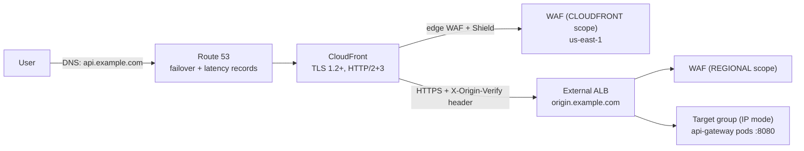

### 11.2 Route 53 (DNS)

| Terraform resource | What it does |
|---|---|
| `data.aws_route53_zone.this` | Looks up your existing public hosted zone (`var.domain_name`) |
| `aws_route53_record.origin` | `origin.<domain>` → ALB alias (what CloudFront uses as origin; has its own ACM cert) |
| `aws_route53_health_check.primary` | HTTPS check on the CloudFront domain `/actuator/health/liveness` every 30 s |
| `aws_route53_record.api_primary` | `api.<domain>` **failover PRIMARY** alias → CloudFront, tied to the health check |
| `aws_route53_record.api_secondary` | **Failover SECONDARY** → DR endpoint (created only when `var.dr_alias_dns_name` is set) |
| `aws_route53_record.api_latency` | `latency.<domain>` **latency-based** record for the current region (add the same name with another region's alias for multi-region) |
| ACM validation records | DNS validation of the certificates |

How to configure: have a hosted zone for your domain, then `terraform apply -var domain_name=example.com ...`; delegate the domain's name servers to the zone.
Verify: `dig api.example.com +short` (CloudFront IPs); stop the origin and watch the health check flip and the record fail over.

### 11.3 CloudFront (CDN)

`aws_cloudfront_distribution.this`:
- **Alias** `api.<domain>` with an ACM certificate created in **us-east-1** (CloudFront requirement) - `aws_acm_certificate.edge` + validation.
- **Origin** = `origin.<domain>` over `https-only`; adds a secret header `X-Origin-Verify` (value `var.origin_verify_secret`).
- **Behavior for an API**: caching **disabled** (`Managed-CachingDisabled` policy) and `AllViewerExceptHostHeader` origin-request policy, all methods allowed, `redirect-to-https`, compression.
  CloudFront is used here for TLS termination near the user, DDoS absorption, HTTP/3 and the edge WAF - not for caching API responses. Add cache behaviors for static assets if you host a front end.
- `minimum_protocol_version = TLSv1.2_2021`.

### 11.4 AWS WAF

Two Web ACLs generated from the same rule set (`local.managed_rule_groups`):

| ACL | Scope / region | Attached to |
|---|---|---|
| `aws_wafv2_web_acl.edge` | `CLOUDFRONT`, **us-east-1** | CloudFront (`web_acl_id`) |
| `aws_wafv2_web_acl.regional` | `REGIONAL` | External ALB (`aws_wafv2_web_acl_association.alb`) |

Rules: `rate-limit-per-ip` (block > 2 000 requests / 5 min per IP) + AWS managed groups **CommonRuleSet** (XSS, bad inputs), **SQLiRuleSet**, **KnownBadInputsRuleSet`. Each has CloudWatch metrics and sampled requests.
Tune by switching a group to `count` mode first (`override_action { count {} }`) to observe false positives. Test: `curl "https://api.example.com/?q=<script>alert(1)</script>"` → `403` from WAF.

### 11.5 Shield Advanced

`aws_shield_protection.cloudfront` and `aws_shield_protection.alb` register both resources with **AWS Shield Advanced** (L3/L4/L7 DDoS detection, response team, cost protection).
**Prerequisite:** an active Shield Advanced subscription on the account (a paid, 1-year commitment). Without it `terraform apply` fails on these two resources - delete/comment them to use only the free Shield Standard that CloudFront/Route 53 already include.

### 11.6 Origin lock-down (defence in depth)

1. The ALB security group (`aws_security_group.alb`) only accepts **CloudFront's origin-facing prefix list** on 443.
2. The ALB listener's default action is a `403`; only requests carrying the correct `X-Origin-Verify` header are forwarded (`aws_lb_listener_rule.from_cloudfront`).
3. The ALB talks to pods inside private subnets; only the EKS cluster SG rules `alb_to_gateway` (8080) and `alb_health_checks` (9090) are opened.

---

## 12. Terraform walkthrough (and why Terraform, not Ansible)

### 12.1 What Terraform builds

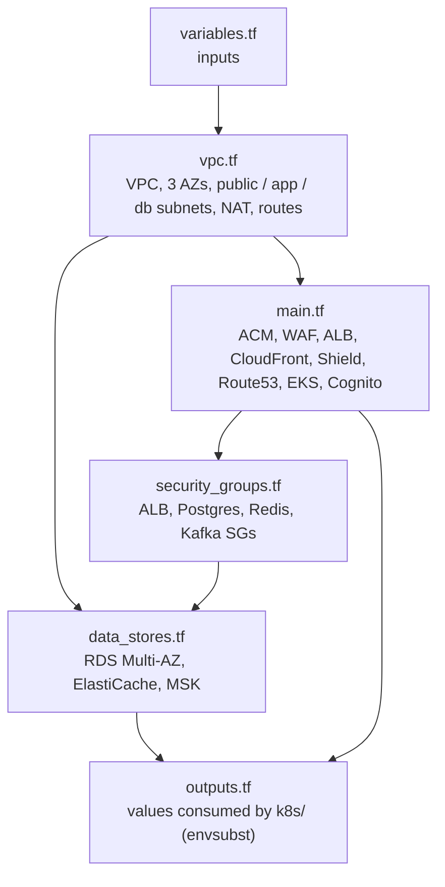

### 12.2 In which order should you read the files?

| Order | File | Read it to understand | Key resources |
|---|---|---|---|
| 1 | `variables.tf` | The knobs: region, domain, VPC CIDR, secrets, DR endpoint, node sizes | `variable` blocks |
| 2 | `vpc.tf` | The network - everything else lives in it | `aws_vpc`, 3 × `aws_subnet` (public / private_app / private_db), `aws_nat_gateway` (one per AZ), route tables, DB subnet groups |
| 3 | `security_groups.tf` | Who may talk to whom (firewall rules) | `alb`, `postgres`, `redis`, `kafka` SGs and the rules that open 8080/9090 to the ALB |
| 4 | `main.tf` | The "big" file, read top to bottom by banner: providers → certificates → WAF → ALB → CloudFront → Shield → Route 53 → EKS → Cognito | see 11 and below |
| 5 | `data_stores.tf` | Stateful services in the isolated DB subnets | `aws_db_instance` (Multi-AZ), `aws_elasticache_replication_group`, `aws_msk_cluster` |
| 6 | `outputs.tf` | What you copy into Kubernetes | RDS/Redis/MSK endpoints, target group ARN, issuer URI |

Terraform itself does **not** execute files in this order; it reads **all** `.tf` files in the folder as one configuration, builds a **dependency graph**
from references (e.g. `aws_subnet.public[*].id` inside `aws_lb`) and creates independent resources in parallel. Visualise it with `terraform graph | dot -Tsvg > graph.svg`.

### 12.3 How `main.tf` flows (section by section)

1. `terraform {}` + two `provider "aws"` blocks - default region and an **alias `us_east_1`** (CloudFront certs and WAF-for-CloudFront must live there).
2. `locals` + zone lookup - shared names (`api_fqdn`, `origin_fqdn`) and the managed WAF rule-group list.
3. **ACM certificates** (`origin`, `edge`) with Route 53 DNS validation.
4. **WAF** ACLs (edge + regional).
5. **External ALB** (+ target group `target_type=ip`, HTTPS listener, header-check rule, WAF association, `origin.` DNS record).
6. **CloudFront** distribution.
7. **Shield Advanced** protections.
8. **Route 53** health check, failover, latency records.
9. **EKS**: KMS key for secret encryption, cluster IAM role, `aws_eks_cluster` (control-plane logs), node IAM role + policies, `aws_eks_node_group` in the private app subnets, **OIDC provider** (IRSA - lets pods assume IAM roles).
10. **Cognito**: user pool with custom attributes `tenant_id`, `user_location`, groups `CUSTOMER`/`ADMIN`, app client.

### 12.4 Using it

```bash
cd terraform
terraform init                                   # downloads providers
terraform fmt && terraform validate              # style + syntax
terraform plan -out tfplan \
  -var domain_name=example.com -var origin_verify_secret='<long-random>'
terraform apply tfplan                           # ~30-40 min (EKS, RDS Multi-AZ, MSK are slow)
terraform output                                 # endpoints for Kubernetes
# when finished:  terraform destroy                (deletion protection on RDS/ALB must be turned off first)
```
Cost warning: 3 NAT gateways, EKS, Multi-AZ RDS, MSK, ElastiCache, Shield Advanced are **expensive** - use a sandbox account and destroy afterwards. Use a **remote backend** (S3 + DynamoDB locking) for teams; none is configured here.

### 12.5 Why Terraform instead of Ansible?

| Criterion | **Terraform** | **Ansible** |
|---|---|---|
| Model | **Declarative** - describe the desired end state; Terraform computes the changes | Mostly **procedural** - ordered tasks (modules are idempotent, but you script the steps) |
| State | Keeps a **state file** → knows what exists, detects **drift**, can delete/replace precisely | Stateless - re-runs tasks, cannot natively know what it created |
| Preview | `terraform plan` shows exactly what will change before anything happens | `--check` mode exists but is less reliable for cloud resources |
| Dependency handling | Automatic **dependency graph**, parallel creation | You order tasks yourself |
| Cloud coverage | First-class providers for AWS (VPC, EKS, WAF, Route 53, RDS, MSK, Cognito…) | Capable, but better suited to configuring servers |
| Lifecycle | Create → update → **destroy** whole environments consistently | Destroying is manual task design |
| Best at | **Provisioning infrastructure** | **Configuring machines** (packages, files, services) |

Benefits we get here:
- **Reproducibility:** the same code creates dev/stage/prod; **reviewable** in pull requests (`plan` output) and versioned in Git.
- **Safety:** drift detection, `prevent_destroy`/deletion protection, dependency ordering (e.g. WAF before CloudFront, certificates validated before listeners).
- **Right tool for the layer:** our workloads are **containers on EKS**, so there is no server configuration for Ansible to do - Kubernetes manifests handle the app layer.
- Honest trade-offs: Terraform needs state management and care with secrets in state; HCL is a new language; destroying/replacing resources can be disruptive. Ansible still makes sense for VM fleets, OS hardening and one-off operational tasks - and the two can be combined (Terraform provisions, Ansible configures).

---

## 13. Kubernetes walkthrough for beginners

### 13.1 Mental model in 60 seconds

| Kubernetes object | Think of it as | In this repo |
|---|---|---|
| **Namespace** | A folder/room that groups resources | `travel-platform` |
| **Pod** | One running copy of your app container | each microservice instance |
| **Deployment** | "Keep N identical pods running; replace them gradually on update" | one per service |
| **Service** | A stable internal address/load balancer in front of the pods | `booking-command-service:8081` |
| **ConfigMap / Secret** | Settings / sensitive settings injected as env vars or files | `platform-config`, `platform-secrets` |
| **Probes** | Health questions kubelet asks | readiness & liveness on port 9090 |
| **HPA** | Autoscaler that changes the replica count | `hpa-*.yaml` |
| **Ingress / TargetGroupBinding** | The door from outside the cluster | AWS ALB |
| **Certificate** (cert-manager CRD) | "Please issue and renew a TLS cert into a Secret" | `mtls-certificates.yaml` |

### 13.2 Where to start - read in this order

| Step | File | Question it answers | How it works internally |
|---|---|---|---|
| 1 | `k8s/namespace.yaml` | Where do things live? | Creates namespace `travel-platform`; every other manifest has `namespace: travel-platform` |
| 2 | `k8s/configmap-secrets.yaml` | How do pods get settings? | A **ConfigMap** (`platform-config`) holds `KAFKA_BOOTSTRAP`, `DB_URL`, `REDIS_HOST`, `JWT_ISSUER_URI`, `EUREKA_URL`…; a **Secret** (`platform-secrets`) holds `DB_USER`/`DB_PASSWORD`. Pods consume both via `envFrom`; Spring's relaxed binding maps env vars to properties (`DB_URL` → `${DB_URL}` placeholders in `application.yml`). `${...}` values are filled by `envsubst` from `terraform output` |
| 3 | `k8s/workloads.yaml` | How do the apps actually run? | For each of the 6 services: a **Deployment** + **Service**. Deployment pieces: image from ECR; `envFrom` the config; `SPRING_PROFILES_ACTIVE=prod,mtls` (gateway/command/query/payment) and `MANAGEMENT_SERVER_PORT=9090`; readiness/liveness probes at `/actuator/health/readiness|liveness` on the management port; CPU/memory requests+limits; `topologySpreadConstraints` spreading pods across AZs; a `tls` volume mounting Secret `<service>-tls` at `/etc/certs`. The **Service** gives a stable DNS name |
| 4 | `k8s/mtls-certificates.yaml` | How is pod-to-pod traffic encrypted? | **cert-manager** chain: self-signed `Issuer` → CA `Certificate` (secret `travel-internal-ca`) → CA `Issuer` → one `Certificate` per service (server **and** client usages, DNS names of its Service) → Secret `<service>-tls` (`tls.crt`, `tls.key`, `ca.crt`) → mounted at `/etc/certs` → Spring **SSL bundle** `mtls` (`application-mtls.yml`) with `client-auth: need` |
| 5 | `k8s/external-alb-ingress.yaml` | How does internet traffic reach the gateway? | `TargetGroupBinding` (AWS Load Balancer Controller CRD): registers the **pod IPs of Service `api-gateway`** into the Terraform-created ALB target group and adds the SG rules. Path: CloudFront → ALB → pod IP:8080 |
| 6 | `k8s/internal-service-lb.yaml` | Is there an internal L7 balancer? | An **Ingress** with `scheme: internal`, `ssl-policy` TLS 1.3, HTTPS backend, health check on 9090, path routing to command/query services (for traffic from other VPCs). In-cluster calls still use Eureka + mTLS |
| 7 | `k8s/hpa-booking-command.yaml`, `k8s/hpa-travel-query.yaml` | How does it scale? | **HPA v2**: scale 3→30 pods when CPU > 70 %, memory > 80 % **or** a custom metric `http_server_requests_per_second` > 1 000 per pod; fast scale-up, slow scale-down (stabilisation 300 s) |
| 8 | `k8s/prometheus-adapter-rules.yaml` | Where does the request-rate metric come from? | Helm values for **prometheus-adapter**: turns the Prometheus counter `http_server_requests_seconds_count` into the Kubernetes custom metric `http_server_requests_per_second` that the HPA reads |

### 13.3 Follow one request through the cluster

1. Browser → `https://api.example.com` → CloudFront → External ALB.
2. ALB target group contains **pod IPs** of `api-gateway` (kept up to date by the `TargetGroupBinding`).
3. Gateway pod validates JWT/rate limit, asks its Eureka registry for `booking-command-service` instances, picks one and calls it over **mTLS** (certs from `/etc/certs`).
4. The command pod writes to RDS (`DB_URL` from the ConfigMap, password from the Secret) and returns `201`.
5. Kafka/Debezium/payment/query services do the rest asynchronously.
6. If traffic rises, Prometheus sees more requests → prometheus-adapter exposes the metric → HPA adds pods → the Service automatically includes them once their readiness probe passes.

### 13.4 Hands-on (beginner exercise)

Prerequisites on the cluster: AWS Load Balancer Controller, cert-manager, metrics-server, prometheus-adapter.

```bash
kubectl apply -f k8s/namespace.yaml
# export the variables shown in the "Deploy to AWS" block below, then:
for f in configmap-secrets mtls-certificates workloads external-alb-ingress hpa-booking-command hpa-travel-query; do
  envsubst < k8s/$f.yaml | kubectl apply -f -
done

kubectl get all -n travel-platform                       # pods, services, deployments
kubectl get certificate,secret -n travel-platform        # certificates Ready? secrets *-tls created?
kubectl describe pod <pod> -n travel-platform            # events: image pull, probe failures
kubectl logs -f deploy/booking-command-service -n travel-platform      # JSON logs with traceId/userId/tenantId
kubectl port-forward svc/discovery-server 8761:8761 -n travel-platform  # open Eureka dashboard
kubectl get hpa -n travel-platform -w                    # watch autoscaling
kubectl rollout status deploy/api-gateway -n travel-platform
```
Experiments: delete a pod (`kubectl delete pod …`) and watch the Deployment recreate it; scale manually (`kubectl scale deploy/payment-saga-service --replicas=5`); break the readiness probe path and see the pod removed from the Service endpoints (`kubectl get endpoints`).

### 13.5 Deploy to AWS (end to end)

```bash
cd terraform && terraform init && terraform apply -var domain_name=example.com -var origin_verify_secret=...
cd ..
kubectl apply -f k8s/namespace.yaml
export ECR_REGISTRY=... IMAGE_TAG=1.0.0 APP_DOMAIN=example.com DB_PASSWORD=... \
       RDS_ENDPOINT=$(terraform -chdir=terraform output -raw rds_endpoint) \
       REDIS_ENDPOINT=$(terraform -chdir=terraform output -raw redis_endpoint) \
       MSK_BOOTSTRAP=$(terraform -chdir=terraform output -raw msk_bootstrap_brokers_tls) \
       JWT_ISSUER_URI=$(terraform -chdir=terraform output -raw cognito_issuer_uri) \
       GATEWAY_TARGET_GROUP_ARN=$(terraform -chdir=terraform output -raw gateway_target_group_arn) \
       EXTERNAL_ALB_SECURITY_GROUP_ID=$(terraform -chdir=terraform output -raw external_alb_security_group_id)
# build & push images:  docker build -f <module>/Dockerfile -t $ECR_REGISTRY/<module>:$IMAGE_TAG . && docker push ...
for f in configmap-secrets mtls-certificates workloads external-alb-ingress hpa-booking-command hpa-travel-query; do
  envsubst < k8s/$f.yaml | kubectl apply -f -; done
```
Also: load `db/V1`/`db/V2` into RDS, create the `travel_app` DB role, enable `rds.logical_replication`, run Debezium Connect against RDS/MSK (the local compose file is not used in AWS).

> Notes for local clusters (kind/minikube): skip `external-alb-ingress.yaml` and `internal-service-lb.yaml` (AWS-specific), install cert-manager, and use
> `SPRING_PROFILES_ACTIVE=prod` if you do not want mTLS. This path is plausible but untested.

---

## 14. Observability

| Concern | Implementation |
|---|---|
| Metrics | `micrometer-registry-prometheus` → `/actuator/prometheus` (management port 9090 in Kubernetes); common tag `application`; HTTP histograms enabled for p95 |
| Dashboards | `observability/grafana-dashboard.json` (request rate, p95, 5xx, heap, CPU, Hikari, circuit breaker state, Kafka lag, threads, 429s) |
| Tracing | `micrometer-tracing-bridge-otel` + OTLP exporter (`OTLP_ENDPOINT`, default Jaeger on `localhost:4318`); sampling 100 % (lower in production). The W3C `traceparent` is stored in `outbox_events.traceparent` and forwarded by Debezium as a Kafka header, so traces continue **through** the CDC hop; Kafka producer/consumer observation is enabled |
| Logging | `logback-spring.xml` → JSON (`LogstashEncoder`) with MDC keys `traceId`, `spanId`, `userId`, `tenantId` and `service` |
| Health | Actuator liveness/readiness probes used by Kubernetes and the ALB |

---

## 15. Repository layout, known limitations, troubleshooting

```text
.
├── pom.xml                         parent POM (Spring Boot 3.3.5, Spring Cloud 2023.0.3, Java 21)
├── docker-compose.yml              local infrastructure (Postgres, Redis, Kafka, Connect, Keycloak, Jaeger, Prometheus, Grafana)
├── config-server/ discovery-server/ api-gateway/
├── booking-command-service/ flight-hotel-query-service/ payment-saga-service/
├── db/                             V1 schema + partitioning + indexes, V2 sample data, SHARDING.md
├── debezium/                       outbox connector definition
├── k8s/                            Kubernetes manifests
├── terraform/                      AWS infrastructure as code
├── observability/                  prometheus.yml, grafana-dashboard.json
└── postman/                        collection + environment
```

### Known limitations

- No inventory/seat locking; `flightId`/`hotelId` in a booking are **not validated** against the catalogue and there is no FK.
- `outbox_events` rows are never deleted (add a purge job or delete-after-insert in the same transaction).
- Payment gateway is simulated; refunds are recorded, not executed at a provider; no partial refunds.
- Booking lookup (`/travel/bookings/{id}`) is not restricted to the owning user.
- The read side shares the demo Postgres; the L2 cache uses JDK serialization; Config Server and Eureka are unauthenticated.
- The `V1`/`V2` scripts are applied by Docker's init mechanism only on first start (no Flyway/Liquibase versioning).
- Terraform/Kubernetes/mTLS-on-Eureka have not been run against real AWS by the author - validate in a sandbox first.

### Troubleshooting

| Symptom | Likely cause / fix |
|---|---|
| Token request: *Account is not fully set up* | User lacks email/first/last name or has required actions - fill them in Keycloak |
| `401` with a valid-looking token | `iss` mismatch - token requested via a different host than `JWT_ISSUER_URI`; keep `localhost:8180` |
| Token has no `tenant_id` / `user_location` | Unmanaged attributes disabled, or mapper missing "Add to access token" |
| `403` on create booking | `tenantId` in body ≠ token `tenant_id`, or `user_location` not in the allowed list |
| Booking stuck in `PENDING_PAYMENT` | Debezium connector not RUNNING, payment service not started, or Kafka topics missing - check `/connectors/.../status` and service logs |
| `503` from gateway | Service not yet registered in Eureka (wait ~30 s) or circuit open |
| `429` | Rate limit hit (expected under load tests) |
| Connector `FAILED` | `wal_level=logical` missing (compose sets it); slot already exists - drop `travel_outbox_slot` |
| Column `passenger_name` does not exist | Old Postgres volume - `docker compose down -v` then up again |
| Port already in use | Another service on 8080-8083/8761/8888 |

---

*Last updated: October 2026.*
